<div align="center">
  
  <h1>DeepSeek Monitor Windows</h1>
  <p>
    
    
    
  </p>
  <p>
    <a href="https://github.com/Tsuki-hash/DeepSeekMonitorWindows/releases/latest">下载安装</a> ·
    <a href="https://github.com/Tsuki-hash/DeepSeekMonitorWindows/issues">反馈问题</a> ·
    <a href="README.md">简体中文</a> / <a href="README_EN.md">English</a>
  </p>
</div>

把 DeepSeek 的余额和用量钉在 Windows 托盘上的小面板。点一下图标，就能看到还剩多少钱、今天花了多少、这个月花了多少，以及每个模型的 Token 和缓存命中情况。

只面向 Windows 10 / 11，技术栈是 Tauri 2 + React 18 + Rust。

**本项目不是 DeepSeek 官方产品，与 DeepSeek 公司无关。**

1.3.0 提供常驻「账户 / Agent / 历史」导航。项目与会话从 **Agent** 一步进入；导出和归档在「数据」，目录和后台采集在「采集设置」。1.3.0 包含透明度控制、完整历史、趋势提示及零用量模型折叠，可从 [GitHub Releases](https://github.com/Tsuki-hash/DeepSeekMonitorWindows/releases/tag/v1.3.0) 下载。

## 界面

1.3.0 发行安装包于 2026-10-10 更新，包含本轮功能与界面调整。

| 深色皮肤 | 浅色皮肤 |
| :---: | :---: |
| 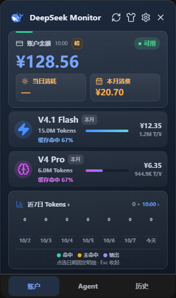 | 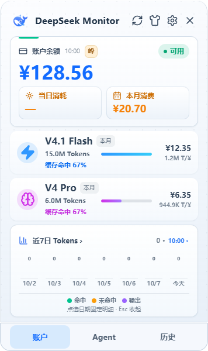 |

<details>
<summary>查看模型详情</summary>


</details>

<details>
<summary>查看用量历史</summary>

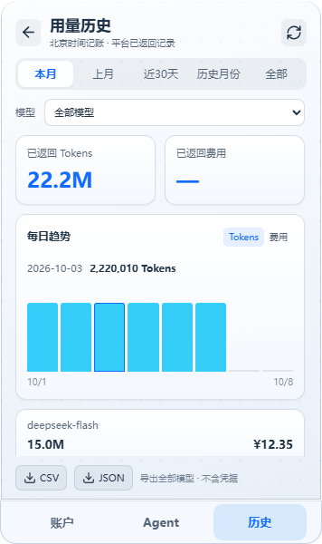

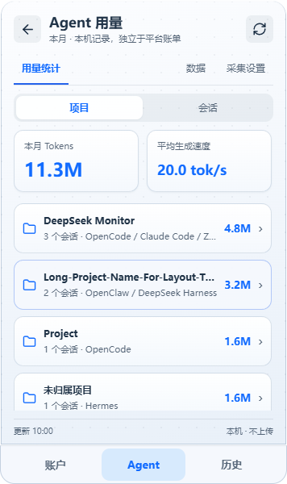

</details>

*以上截图使用 1.3.0 当前界面与合成演示数据，不包含真实账户信息。*

<details>
<summary>查看余额与预算提醒设置</summary>

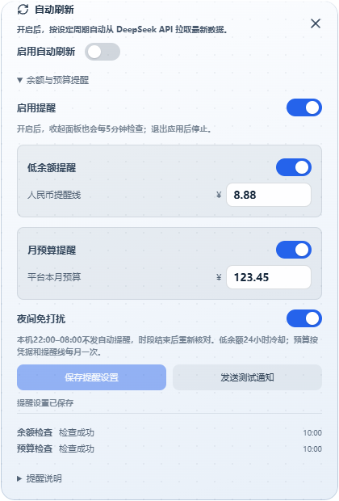

</details>

## 为什么会有这个项目

DeepSeek 官方只开放了余额接口，没有账户级的用量接口。网页端的用量页虽然能看到消费，但看不到「缓存命中 / 缓存未命中 / 输出」这种按模型拆开的明细，也没办法常驻桌面随时瞄一眼。

这个项目把三件事拼在一起：

- **余额** —— 用官方 API Key 直接调 `/user/balance`。
- **用量** —— 复用网页登录态换来的用量 Token，调平台内部接口，拿到当月消费、Token 总量、请求数和缓存明细。
- **呈现** —— 合并成一个常驻托盘、不占任务栏的窄面板，随开随关。

## 安装与上手

### 安装

从 [Releases](https://github.com/Tsuki-hash/DeepSeekMonitorWindows/releases/latest) 下载最新已发布版本的 `x64-setup.exe` 安装。覆盖安装不需要先卸载旧版本。

运行环境：Windows 10 或 Windows 11，以及 Microsoft Edge WebView2 Runtime（Windows 11 自带，Windows 10 若缺失需单独安装）。

### 填 API Key

打开主面板 → 右上角设置 → 「API Key」区块，粘贴你的 Key（在 DeepSeek 开放平台的 API Keys 页面生成），点 **验证并保存**。验证通过后，设置页会直接显示当前余额，主面板也会开始刷新。

### 同步用量

用量要用另一个凭据，见「两种凭据，别混」一节。

### 日常使用

- 点窗口右上角的关闭按钮 = **隐藏到托盘**，不是退出。
- 左键托盘图标：显示 / 隐藏面板。
- 右键托盘图标：显示主面板 / 最近查询余额 / 退出；悬停也可看余额。显示最近成功快照，更新失败标旧数据；未取得或凭据失效不显示余额数字。隐藏面板后不会为此额外查询。
- 设置「外观 → 桌面快捷操作」可开启面板置顶或 **Ctrl + Alt + D** 显隐，两项默认关闭。快捷键被占用或保存失败会提示并恢复原设置。
- 设置「关于 → 帮助与诊断 → 检查更新」会核对 GitHub 最新正式发行版本，区分发现新版、已是最新和开发版领先；可另点「查看发行页面」。仅手动检查，不自动下载或安装。
- 模型行显示本月用量，趋势图显示包含今天的近7日；记账时区为东八区。
- 余额更新时间旁的“峰／谷”标签按北京时间显示当前计价时段：峰为淡琥珀色，谷为淡青绿色。点击查看下一切换和规则；谷价为峰价的一半。节假日采用国务院2026年整段放假日历，周末调休上班仍为谷；未覆盖年份的潜在高峰显示“—”待核对。该标签是规则提示，实际扣费以平台账单为准。
- 余额与用量各有更新时间，按电脑本地时区显示；同月用量更新失败保留最近成功数据，跨月旧累计不继续作为本月展示，未取得的新日期标为未知；可查看原因、重试或重新同步。
- 图表可指向预览、点击固定明细；键盘 Tab 选择日期，Enter / Space 固定，Esc 收起。数据明细显示在图表下方。
- 点击底部「历史」进入平台用量历史，可查本月、上月、近30天、指定历史月份或全部历史。全部历史从2020年起按接口允许范围逐月加载，优先最近月份，显示进度并支持停止；趋势按月展示并可横向浏览。未返回的记录保持未知，无法保证平台长期保留所有月份。
- 历史趋势悬停显示日期与完整数值，点击固定、方向键切换、Esc 收起；高亮仅覆盖实际柱体。默认隐藏明确零用量模型，勾选「显示无用量模型」可恢复；有消费、未知或异常数据不会按旧模型名称删除。
- 「设置 → 外观 → 背景透明度」支持 0–70% 即时调节，自动保存并可恢复默认；文字与图标保持清晰。
- 历史页可手动导出全部模型：CSV 包含所选区间的每日记录；JSON 另包含所查询月份的完整月汇总（近30天跨月时，月汇总范围可能大于30天）。导出不含 Key、Token 或 Cookie；CSV 使用 UTF-8 BOM 并防公式注入。
- 设置「数据状态与口径」中可查看两种数据来源、各自更新状态和数据年龄。历史查询使用最多4个月、5分钟有效的内存缓存；更换或清除用量会话立即作废缓存和旧响应。余额 Key 与用量 Token 是否属于同一账户尚未自动核对。

## 两种凭据，别混

这是最容易踩的坑：查余额和查用量用的**不是**同一个东西。

|  | API Key | 用量 Token |
| --- | --- | --- |
| 从哪里来 | DeepSeek 开放平台 → API Keys 页面 | 登录 platform.deepseek.com 之后的会话 token |
| 用来干什么 | 查账户余额 | 查用量与消费 |
| 能不能互换 | 不能 | 不能 |

**为什么用量非得用 Token**：DeepSeek 没有公开账户级用量接口，只能复用网页端自己在调的那套接口，因此必须借你的登录态。这个 Token 属于会话凭据，和 API Key 一样敏感，而且会过期。

### 方式一：网页登录自动同步

在设置页「用量同步 Token」区块点 **网页登录自动同步**，在弹出的 DeepSeek 登录窗口完成登录。

应用会 hook 页面发出的网络请求，直接从 `Authorization` 头里抓取 Bearer token，验证它确实能调通用量接口之后才保存，然后自动刷新数据。

> 登录需要时间，等待期间可点「取消同步」。验证成功后才保存 Token；取消后旧请求不能重新保存凭据。

### 方式二：手动粘贴（兜底）

点 **方式二：手动粘贴 token** 展开。用浏览器登录 platform.deepseek.com，按 F12 打开开发者工具，**切到「控制台 / Console」标签**，在 `❯` 提示符后输入：

```js
JSON.parse(localStorage.userToken).value
```

复制返回的字符串，粘进输入框，点 **保存 Token**。

若返回 `undefined`（平台可能调整了存储键名），改输入下面这条列出候选键，从结果里找形如 token 的长字符串复制：

```js
Object.entries(localStorage).filter(([k]) => /token/i.test(k))
```

**用量 Token 会过期。查不出用量时，重新同步一次就行。**

## 模型口径

DeepSeek 在 2026-09-10 上线了 V4.1 Flash，模型名从 `deepseek-v4-flash` 改为 `deepseek-flash`。这次变更有个坑：**旧模型名没有被立刻禁用，而是被兼容路由到了新模型**，所以迁移期内同一份账单里可能出现新旧两种名字。本项目的处理方式：

| 平台返回的 model | 归入界面上的哪一行 |
| --- | --- |
| `deepseek-flash` | V4.1 Flash |
| `deepseek-v4-flash` | V4.1 Flash（**累加**） |
| `deepseek-v4-flash-vision-exp` | V4.1 Flash（**累加**） |
| `deepseek-v4-pro` | V4 Pro |

同名归入同一行时是**求和**而不是覆盖——否则一旦新旧名字并存，会有一部分用量被静默丢掉，界面上还看不出来。

另外两件事值得知道：

- **V4 Pro 正常提供。** 与 V4.1 Flash 分开统计，可独立查看 Token、费用与缓存明细。
- **未归类的 Token 有兜底统计。** V4.1 Flash 原生支持图片输入，如果平台返回了本项目尚未分类的 token 类型，这些量会被计入总量，并在图表里以「其他（未归类）」单独显示，而不是静默丢掉。
- **未接入的模型有兜底展示。** 平台返回了本项目尚未接入的模型名时（例如后续新模型上线初期），其用量会聚合为「其他」一行展示（Token、费用、请求数求和），不会静默丢失；新模型正式接入仍以 `model_slot()` 的映射为准。

## 界面上的数字分别是什么

### 主面板

| 位置 | 含义 |
| --- | --- |
| 账户余额 | 官方 `/user/balance` 返回的总额度，含赠送额度与充值额度 |
| 当日消耗 / 本月消费 | 来自平台用量接口的费用字段 |
| 模型行 | 该模型当月的 Token 总量、费用，以及每元能买多少 Token（T/¥）；下方是缓存命中率 |
| 缓存命中明细 | 最近 7 天的按日堆叠柱状图，三段分别是输入（命中缓存）、输入（未命中缓存）、输出 |

### 详情页

点主面板上任一模型行进入。展示该模型的请求次数、Token 总量，以及按日的 Token 消耗分解。

### 用量历史

平台返回异常 Token 计数时，受影响的历史字段保留为未知并显示数据提示；合法零仍显示零。

首页仍按模型组展示；历史页保留平台原始模型 ID，新旧别名和未知模型分别列出，方便核对。按需查询平台内部接口，不保证平台长期保留全部历史月份；近30天只合计已返回的每日记录。

### 本地项目与会话

本地CSV／JSON保留实际统计月份和采集时电脑的UTC偏移。旧快照缺少的信息保留为空；从项目进入会话后保存快照，只保留当前项目内的会话数据。

Agent →「数据」→「导出」折叠区支持 CSV / JSON：按当前全部记录、项目或会话导出用量元数据，保留未知值和采集时间。默认排除完整项目路径、内部行ID、源会话标题、对话正文及凭据；只有主动勾选「包含项目完整路径」才带路径。CSV 使用 UTF-8 BOM 和公式注入防护，来源可能含 Token 估算，不作为实际账单。

点击底部「Agent」，首次点「开启本地统计」。项目／会话可直接切换；导出与归档位于「数据」，目录与后台采集位于「采集设置」。参考 [Token Monitor](https://github.com/Javis603/token-monitor) 的采集方式，使用固定版本 Tokscale 读取 OpenCode、Claude Code、ZCode、Hermes、OpenClaw 和 DeepSeek Harness 的本机记录；按项目进入会话，查看原始模型、输入/输出/缓存/推理分段。项目或字段未记录时显示未知，不猜测。此版提供本月的会话按模型明细，逐条请求详情仍待扩展，本地后台采集现可单独开启；ZCode指定本地数据库已支持。

tok/s 使用可靠输出 Token 与生成耗时：首次采集显示有耗时记录的平均值，后续新增性能记录显示近期速度，不以扫描间隔作分母。部分耗时覆盖或无耗时时显示 —；这是记录更新后的速度，不是逐 Token 流式测速。

统计口径由工具日志和采集引擎决定。例如旧版ZCode缺少原始计数时，Tokscale会根据文本估算Token；此版尚不能逐行区分实测与估算，因此本地数字不能作为实际账单。界面不自行猜测缺失归属或补齐引擎未返回的字段。

部分工具仅记录会话累计用量，月份归属取源记录时间，不保证将跨月会话按日准确分摊。

本地统计包含工具记录的所有模型，未验证这些记录属于当前 DeepSeek 账户，不与平台账单相加，也暂不估算费用。本月按电脑本地日期查询。默认仅在该页可见时采集，可另外开启后台采集；关闭统计暂停采集并清内存，保留会话留存、引擎缓存及原工具日志。界面与IPC仅保留用量元数据，不展示或上传正文/源代码；引擎在本应用配置目录下 `local-usage-engine/` 缓存统计元数据，可能含源会话标题，界面不展示标题。配置开关保存在同目录 `local-usage-enabled.json`。

展开本地页「采集目录」，可保留本机默认目录，并按行添加最多3个额外用户主目录，例如 `D:\AgentData\User` 或 `\\wsl.localhost\Ubuntu\home\user`。填写包含 `.claude`、`.hermes` 等标准子目录的用户主目录，不是项目目录或单个日志文件；支持的单工具数据路径可在下方入口设置。保存先校验格式，可访问性在采集时检查，失败保存保留原设置；成功保存取消旧采集、清除旧快照及速度基线。偏好保存在 `local-usage-sources.json`，不改写或删除源日志。默认目录沿用引擎环境变量规则；额外目录按固定引擎的 `--home` 布局读取，源主目录的引擎设置可能影响额外路径/别名解析。

WSL只查询已注册且正在运行的发行版，不执行安装、启动或Linux命令；未运行/无法确认的来源跳过。相同规范主目录去重，不同主目录的项目和同名会话隔离，Linux路径保留大小写；复制到不同目录的日志仍可能重复计数。部分来源失败只合计成功来源并标记不完整，全部失败保留旧快照。每源30秒、总60秒预算，目录检查3秒且最多1个未结束的文件系统探测；引擎缓存按来源放在本应用目录。JSON导出schemaVersion=2、CSV带来源ID/标签和完整性，默认仍无完整路径或目录错误详情。真实WSL文件访问、SQLite竞争与工具版本覆盖待原生验收。

展开「采集目录 → 单工具数据路径」添加工具与记录位置，保存后采集。单工具数据路径首版：采集目录内默认折叠，可添加最多3项、每款工具一项。OpenCode选opencode.db/opencode-渠道.db（拒绝WAL/SHM）；Claude Code选projects、Hermes选含state.db的目录、OpenClaw选agents、DeepSeek Harness选sessions。支持本地及运行中的WSL绝对路径，ZCode现可指定本地数据库文件，其WSL单库路径暂不支持。保存成功作废旧快照/速度/选中范围；失败保留设置与草稿。使用本应用的空采集home和隔离scanner设置，写app缓存而非工具配置，不复制活跃数据库；每来源独立ID/缓存，部分失败标不完整。不要重复添加已被默认或主目录覆盖的同一批日志，跨来源重叠可能重复计数。

数据质量初版：本地页默认折叠，按当前全部/项目/会话汇总Token字段齐全、缺失、待核对与耗时匹配、部分覆盖、未取得、未核对；模型明细显示简短质量标签。计数来源统一标未标定（tokenAccuracy=unclassified），字段齐全不代表实测；固定引擎没有逐请求/逐条实测或估算标记，不伪造这些数据。JSON schema2/CSV追加tokenAccuracy、tokenFields、timingCoverage白名单字段，不导出路径或正文；旧数据质量明确标上次结果。单行与多行汇总超过安全整数保持未知，速度不使用无效汇总。

五工具单路径支持运行中的WSL UNC深层目录/规定名OpenCode数据库。只放行已确认运行且发行版匹配的来源，否则跳过并标部分失败；Windows服务器别名归一、Linux完整路径大小写保留。目录与文件类型仍在受限探测中核对，保存不启动WSL；使用本应用隔离引擎设置，不写源日志/工具配置、不复制数据库。路径输入对WSL换行展示，减少长路径裁切。ZCode指定本地数据库已支持，其WSL单库路径暂不支持。

### 指定ZCode本地数据库

ZCode指定本地数据库已接入：展开“采集目录 → 单工具数据路径”，选择ZCode并填写本地.db／.sqlite／.sqlite3文件。按Token Monitor固定Tokscale的model_usage规则，只查询会话／模型／项目／计数／时间元数据；现代表按computed_total_tokens识别缓存／推理包含关系，旧表采用对应扣除规则，现代NULL总量不误当旧表。缺失／负值／超限计数保留未知，不补零、不估算费用，精度仍为unclassified。接入现有本月项目／会话、速度、导出与手动快照，版本标记为d5e8ad9b+zcode-sqlite-v1；原固定引擎与SHA不变。

此入口仅支持本地文件，拒绝WSL／其他共享以及WAL／SHM旁文件；原有五工具WSL入口保持。只读连接＋query_only，不复制活跃库、不执行SQL写入或checkpoint、不改工具配置；SQLite可能使用WAL／SHM协调文件，不承诺对辅助文件零接触。每次500ms锁等待、30秒查询／60秒总采集，单实际读取worker、进度取消、5万本月行／16MiB元数据／128KiB SQLite长度上限。超时／取消请求停止，OS阻塞可能继续，但worker退出前不放开名额。坏库、重复标识／关联、结构不兼容、超限或锁失败为未取得，部分源继续、全失败保留旧结果并提示来源失败原因；不会把读错当零。

标准home入口仍由固定引擎采集；请勿同时添加其已覆盖的同一数据库，跨来源重叠可能重复计数。查询期间按电脑本地月份，开始时间优先、缺失时完成时间减正耗时、再退到文件修改时间；这是记录归属，不是逐日账单。仅具备完整匹配耗时才显示速度。

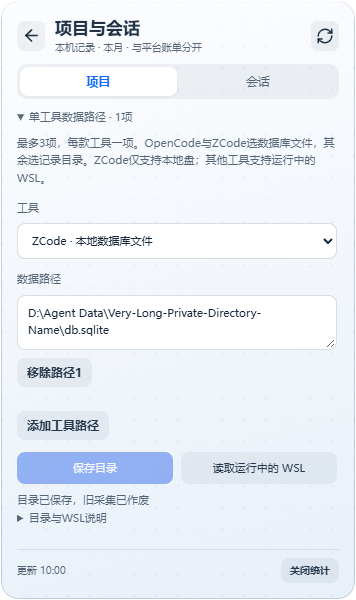

### 手动保存与查看快照

手动快照归档初版：Agent →「数据」中展开“保存快照与历史归档”，可按全部／项目／会话保存已接收的本月模型汇总。历史页独立查看、CSV／JSON导出，单份删除与清空全部均二次确认；归档不更新、不与当前统计或其他快照相加。默认不保存项目完整路径，显式勾选才包含；会话ID及项目名称保留，内部项目键哈希化，不复制正文、凭据或源标题。应用配置旁local-usage-archive.json存放明文用量元数据（schema1），最多12份／总8MiB，满后提示且不覆盖。失败、损坏或未知版本不改写原文件，显式清空可恢复；删除只影响本应用归档，不删工具日志或引擎缓存。未知计数、未标定精度、耗时覆盖、旧结果及不完整来源状态继续保留。

保存只接受后端当前快照及匹配采集时间，统计关闭、采集中、结果变更、系统时钟回退或非当前本地月份均拒绝；多来源采集跨电脑本地月份拒收混合结果，前端跨月清旧累计，已保存归档仍保留原月份。进入归档页停止后续轮询，迟到页面响应作废。手动保留不证明源日志已删除，也不能恢复未曾采集／保存的记录；自动会话留存及可选后台采集已完成；逐请求、逐条实测／估算仍待扩展。


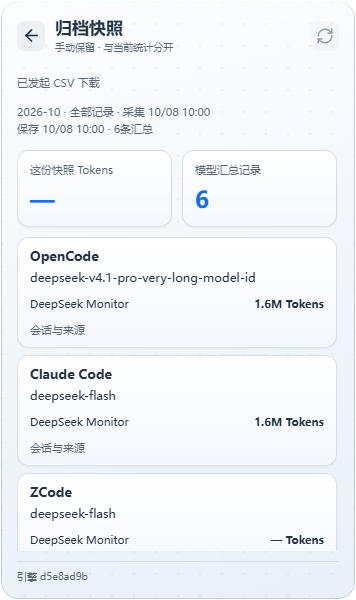

### 后台采集（默认关闭）

✅ 本地后台采集已接入：在 Agent →「采集设置」展开“后台采集”，开启“收起后继续采集”。开关保存于独立的local-usage-background-enabled.json，默认关闭，需先开启本地统计；离页／隐藏到托盘仍采集，退出停止。关闭统计暂停但保留后台偏好，再开启统计后恢复；已开启的后台偏好在启动时恢复。自动会话留存仍是独立开关，启用后后台成功快照也参与留存。历史页面停止前台轮询，但不关闭用户开启的后台采集。

复用固定引擎与同一个collector；前后台不并发采集，来源变化／关闭统计／后台开关修改递增代际并取消旧任务。原生目录事件仅作刷新提示，不用事件推断用量或日志删除；1.5秒静默合并，后台任务开始至少间隔5秒，约60秒兜底，持续事件不饿死兜底，失败按尝试间隔120／240／480／600秒退避。忽略访问事件及纯SQLite -shm变化，避免自身读取触发连续刷新；-wal及真正数据变化仍触发。后台模式下前端定时读取已接受的快照，不另启动重复扫描；手动刷新仍可用。

notify固定8.2.0，无网页新增权限；单监听管理线程＋一个RecommendedWatcher，最多64个候选工具根，指定数据库仅监听父目录的直接变化，不自动递归监听整个用户home，不读取正文。缺失工具根只监听最近存在父目录的直接变化，每60秒重建监听；失败／未覆盖来源靠定时采集，状态只给根数和脱敏警告，不输出完整路径／事件名。额外home和指定路径继续受校验，WSL完全跳过目录监听，采集仍仅访问确认运行的发行版；本地默认环境变量定制路径未保证即时事件覆盖，定时扫描仍沿用引擎完整发现。单管理worker避免堆积，目录探测或监听关闭可能受OS IO延迟，不声称严格即时结束。

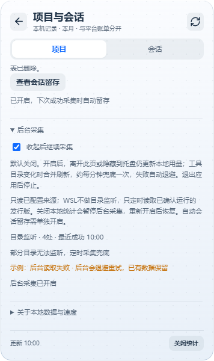

实际Windows托盘隐藏、各工具事件、启动恢复和安装后WebView2行为仍需新包验收；逐请求与逐条精度扩展尚未实现。

### 自动会话留存（默认关闭）

默认关闭的自动会话留存已接入：在本地页展开“保存快照与历史归档 → 自动会话留存”，开启“自动留存已读取会话”。在成功采集并接受新快照后保存已读取的会话（默认前台；另外启用后台时也包括后台），按本地月份／来源／工具／会话ID隔离，更新该会话最新汇总，不取字段最大值；内容及状态未变不重写。未再出现的会话仍保留，但不证明日志已删除，不能恢复从未读到的记录，也不与当前统计或其他记录相加。

独立local-usage-retention.json保存schema1明文元数据，开关在local-usage-retention-enabled.json；最多128条月度会话记录／总8MiB，满后整批拒绝、不自动淘汰。项目键哈希化，不保存项目完整路径、正文、凭据或源标题；会话ID、项目basename与来源标识保留。Mutex及临时文件原子替换，损坏／未知版本／旧时间／非法结构／写入失败不覆盖原记录。留存失败提示但成功读取的当前统计仍可用；偏好无法读取时禁用开关，显式关闭并重置可恢复。

“查看会话留存”独立查看／CSV与JSON下载，导出captureKind=automatic-session-checkpoint，手动快照标manual-snapshot。进入历史停止后续页面轮询，统计关闭仍可查看已有记录。单条删除与全部清空均二次确认，只删除本应用留存，不删手动快照、工具日志或引擎缓存。清空不会关闭自动留存；保持开启时，下次成功采集可能重新保存。所有新增入口默认折叠，首页及原字体布局保持。

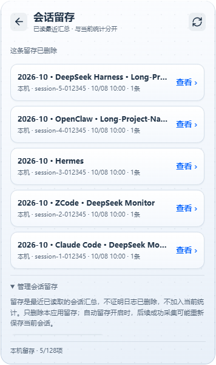

会话留存及可选后台采集已完成；逐请求与逐条精度仍需后续扩展。当前截图是浏览器模拟IPC，不代替实际Windows重启、日志清理和WebView2验收。

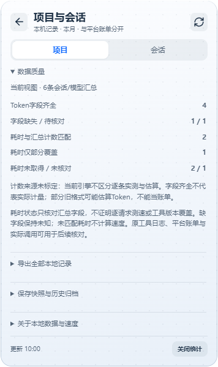

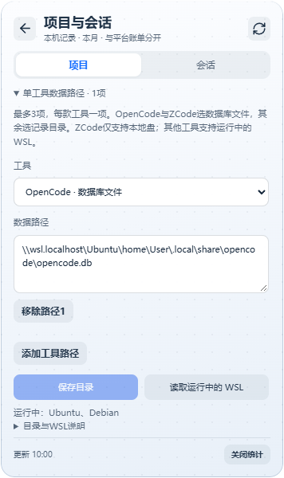

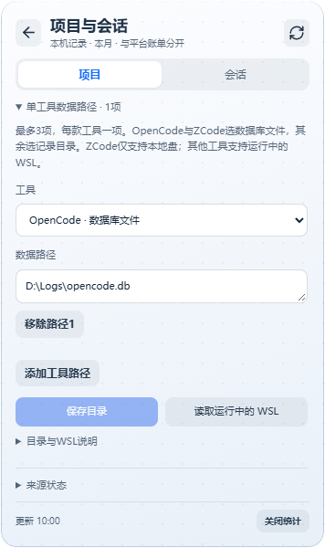

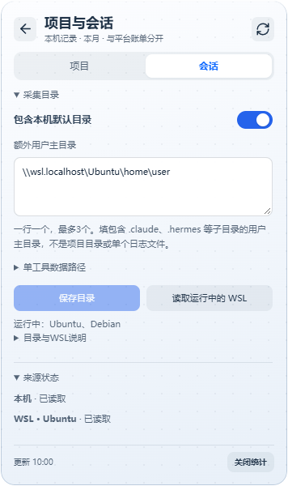

### 余额与预算提醒

关闭的规则保留已保存金额，未保存的空值不阻止另一项规则保存。凭据失效后，重新验证并保存成功会恢复对应检查，同一个Key／Token也适用，通知去重记录保留。

在「设置 → 自动刷新 → 余额与预算提醒」展开设置，开启需要的规则并点「保存提醒设置」。总开关默认关闭；低余额线默认¥10，月预算默认¥100且该项默认关闭。金额可自行修改。开启后应用收起到托盘仍约每5分钟独立检查，退出后停止；这与面板自动刷新开关分开。

低余额仅支持人民币余额；预算只使用平台东八区本月费用，不包含本地Agent统计，也不会阻止消费。只用成功且有效的最新查询判断；失败不通知并退避至最多30分钟，凭据失效暂停对应项，更换凭据或关闭提醒会取消旧检查。余额Key与用量Token的账户尚未自动匹配，两个规则独立判断。

低余额按凭据和提醒线24小时冷却，预算按凭据、提醒线和自然月去重；去重记录在重启后保留。夜间免打扰默认开启，按电脑本机时间22:00–08:00不发自动提醒，结束后重新查询，不补发旧快照。可点「发送测试通知」，至少间隔60秒；测试通知不查询账户、不受本应用夜间时段限制。通知是否可见由Windows设置决定，安装后需核验；“已提交系统”不表示已显示。

通知正文不含金额或凭据。开关/阈值保存在本地配置，`alert-receipts.json`只存去重摘要、尝试时间和系统提交状态（最多128条/90天）；不保存原始Key、Token或金额样本。去重记录无法保存时不发送；提交失败或提交回执不完整时保留尝试冷却，避免重启后立即重复。

### 设置页

API Key 与用量 Token 的配置和清除、开机自启、自动刷新间隔（1 分钟 / 5 分钟 / 30 分钟 / 1 小时）、当前版本号。

## 凭据存在哪里

```text
%APPDATA%\DeepSeekMonitorWindows\config.json
```

API Key 和用量 Token 存在这个文件里，**已用 Windows DPAPI 加密**（`CryptProtectData`，密文以 `DSM1:` 开头的 base64 串保存）。DPAPI 的密钥绑定当前 Windows 用户与这台机器，因此：

- 把 `config.json` 单独拷到别的机器或别的用户下，凭据**解不开**，应用会提示重新填写（其余设置原样保留）。
- 旧版本（v1.2.1 及更早）留下的明文凭据，在应用首次读取时**自动加密回写**，无需手工处理。
- 仍然不要把它提交到任何仓库、分享或备份到云盘——加密只防「文件被顺手拿走」，不防「当前用户下的恶意进程」。
- 在共享电脑上用完，可在设置页清除 Key，并在「账户隐私」中点「退出并忘记账户」清除用量 Token 和本应用的网页登录数据。仅「清除 Token」不会删除网页登录缓存。

网页登录产生的 WebView2 缓存位于 `%LOCALAPPDATA%\com.deepseek.monitor.windows\EBWebView`，属于本机运行数据，同样不应提交到仓库。

## 开发

### 环境要求

- Node.js 22.6+ 与 npm（单测使用 `node --test --experimental-strip-types`）
- Rust 1.88+，建议 MSVC 工具链
- Visual Studio Build Tools 2022，勾选 `Desktop development with C++`

本地统计引擎固定于 Tokscale `d5e8ad9b`，Windows x64资源约25 MiB。`npm run local-usage:prepare` 下载并校验SHA-256；Tauri开发/打包会先执行该步骤，已有合格资源时可离线复用。安装后的统计只读本地工具数据，价格查询禁用，不在运行时下载引擎。生成的exe不入库，固定版本清单与MIT许可证入库；不改变项目Node/Rust最低版本。

最低版本已在 Windows MSVC 环境验证：Node.js 22.6.0（npm 10.8.2）通过前端测试和构建，Rust 1.88.0 通过后端构建和测试。

### 常用命令

```powershell
git clone https://github.com/Tsuki-hash/DeepSeekMonitorWindows.git
cd DeepSeekMonitorWindows
npm install
npm run tauri:dev
```

```powershell
npm run tauri:check    # cargo check（全部 target）
npm run check:version  # 校验三处配置里的版本号是否一致
npm test               # 前端单测（类型 + 用例）
npm run lint           # ESLint
npm run build          # 类型检查 + 前端构建
npm run verify         # 本地一键门禁（需 PowerShell 7+）
npm run tauri:build    # 打包 NSIS 安装包
```

`npm run tauri:dev` 与 `npm run tauri:build` 分别是 `tauri dev` / `tauri build` 的封装，会按需探测本机 VS Build Tools 的位置，不需要手动配路径。若想直接调用 Tauri CLI，`npx tauri dev` 效果相同。

版本号散落在 `package.json`、`src-tauri/tauri.conf.json`、`src-tauri/Cargo.toml` 三处（Tauri 2 的配置不会去读 `package.json`），发版前跑一次 `npm run check:version` 可以避免打出名字对不上的安装包。

**测试**：前端用 Node 22 内置的 `node --test` 配合 `--experimental-strip-types` 直接跑 TypeScript 测试，**没有引入 vitest / jest 这类测试框架**（因此也没有新增任何 devDependency）。后端就是标准的 `cargo test`：

```powershell
npm test                                  # 前端：tsc -p tsconfig.test.json + node --test
cargo test --manifest-path src-tauri/Cargo.toml --lib   # 后端
```

测试覆盖的是「算错了不容易被发现」的那部分：用量口径（`model_slot` 的模型名映射表、`token_breakdown` 的六类 token 归并与 `PROMPT_TOKEN` 双计边界、`merge_model_slot` 的求和语义）、配置读写（旧配置缺字段回退、损坏配置留证重置、原子写不残留临时文件、凭据加解密与明文迁移）、登录 token 解析（上下文特征匹配、截断输入不崩溃），以及前端的跨月补零与单位换算阈值。改动这些地方时，先跑测试再动手。

本仓库**不再启用 GitHub Actions**。推送前请在本地跑一次 `npm run verify`（PowerShell 7+）：依次执行版本一致性、前端测试/lint/构建，以及 `cargo fmt --check`、`cargo clippy -- -D warnings`、`cargo test`。

可选加固：`git config core.hooksPath scripts/hooks` 启用仓库自带的 pre-push 钩子，`git push` 前自动跑一次 `npm run verify`（单次跳过用 `git push --no-verify`）。

安装包产物位于 `src-tauri/target/release/bundle/nsis/`。若报 `Visual Studio Build Tools not found`，请安装 Build Tools 2022 并确认勾选了 C++ 组件。

### 代码结构

```text
DeepSeekMonitorWindows/
├── scripts/                     # check-version.mjs、verify.ps1（本地门禁）
├── src/                         # 前端
│   ├── main.tsx                 # 入口
│   ├── App.tsx                  # 路由与全局刷新状态
│   ├── components/              # 主面板、设置、详情、图表等组件
│   ├── format.ts                # 纯格式化 / 日期工具（有单测）
│   ├── format.test.ts           # 上述模块的单测
│   ├── theme.ts / types.ts / usage-api.ts
│   └── styles.css               # 全部样式，含深色 / 浅色两套皮肤
├── src-tauri/                   # 后端
│   ├── src/lib.rs               # 命令装配、托盘、窗口显隐、HTTP 请求
│   ├── src/config.rs            # 配置结构与读写（有单测）
│   ├── src/credentials.rs       # 凭据的 DPAPI 加解密（有单测）
│   ├── src/usage.rs             # 用量口径（有单测）
│   ├── src/token_sync.rs        # 登录 token 抓取与解析（有单测）
│   ├── tauri.conf.json          # 窗口、打包与安全配置
│   └── capabilities/            # Tauri 权限
├── public/assets/               # 图标与静态资源
├── scripts/check-version.mjs    # 发版时校验三处版本号一致
└── screenshots/                 # README 界面截图
```

界面由 `App.tsx`、`components/` 和共享样式组成，后端按配置、网络、统计、同步和托盘职责拆分。模型名到界面行的映射集中在 `src-tauri/src/usage.rs` 的 `model_slot()`，改模型或加模型从那里入手——它旁边就是覆盖四类模型名的测试，改完立刻能验证。

## 常见问题

**余额能查到，但用量一直是空的？**
两者用的是不同凭据。余额看 API Key，用量看用量 Token——先确认用量 Token 已经配好了。

**提示「用量不可用」或「未配置用量 Token」？**
用量 Token 过期了。去设置页重新点一次 **网页登录自动同步**，或按方式二手动粘贴。

**登录窗口点了没反应 / 一直显示「等待登录」？**
登录本身需要时间，登录完成后页面才会发请求、token 才会被捕获。如果一直没动静，关掉登录窗口再点一次按钮。

**关掉窗口后程序还在后台？**
这是设计如此——「关闭」是隐藏到托盘。要真正退出，右键托盘图标选「退出」。

**Pro 那一行一直是 ¥0.00？**
说明本月几乎没有用 `deepseek-v4-pro` 调用。V4 Pro 与 V4.1 Flash 是分开统计的两行；若你实际调用的是 Flash，请看上一行。

**用量一直失败，余额却正常？**  
两者接口与凭据不同。按顺序试：① 重新「网页登录自动同步」；② 用方式二粘贴新 Token；③ 稍后重试（平台内部接口可能临时变更）。余额一直可用的话，说明 API Key 正常。

**会不会频繁请求 DeepSeek 的接口？**
首页余额和用量在三种时机请求：打开面板（含从托盘唤出）、手动刷新、以及你设定的自动刷新周期（默认关闭，开启后最短 1 分钟）。历史页在进入、切换区间和主动重查时按需查询，5分钟内可复用月缓存。面板收进托盘后自动刷新会暂停，不会在后台轮询。

### 接口失效排查步骤

用量走的是平台内部接口，平台侧调整时可能临时失效。按顺序排查：

1. **看报错文案。** 面板会区分「Token 无效 / 过期」（需重新同步）与「接口暂不可用 / 路径可能变更」（稍后重试）；余额报错与用量 Token 无关。
2. **重新同步 Token。** 设置页点「网页登录自动同步」，登录完成后通常数百毫秒内自动填入；若登录窗口还开着，可多点几次按钮促发刷新。
3. **手动粘贴兜底。** 展开「方式二：手动粘贴 token」，按提示从浏览器取最新 token 粘贴保存。
4. **查诊断日志。** `%LOCALAPPDATA%\com.deepseek.monitor.windows\logs` 记录了每次同步的退出原因与候选校验结果（不含任何凭据内容），可确认卡在哪一步：候选为空、校验未通过、窗口提前关闭或等待超时。
5. **仍无效。** 多半是平台调整了内部接口的路由或鉴权，留意本仓库 Releases 页更新；余额走官方接口，不受影响。

## 来源与致谢

本项目是 DeepSeek Monitor 系列在 Windows 桌面端的延续，**直接承接自 [Joyi-code/DeepSeekMonitorWindows](https://github.com/Joyi-code/DeepSeekMonitorWindows)**，并沿用更早的 macOS 原项目 [JayHome137/DeepSeekMonitor](https://github.com/JayHome137/DeepSeekMonitor) 的产品思路与视觉方向。

| 代次 | 仓库 | 目标平台 | 核心技术 |
| --- | --- | --- | --- |
| 初代 | [JayHome137/DeepSeekMonitor](https://github.com/JayHome137/DeepSeekMonitor) | macOS 菜单栏与 WidgetKit 桌面小组件 | Swift 5.9+、SwiftUI、AppKit、WidgetKit |
| 二代 | [Joyi-code/DeepSeekMonitorWindows](https://github.com/Joyi-code/DeepSeekMonitorWindows) | Windows 桌面端 | Tauri 2、React、TypeScript、Rust |
| 本项目 | [Tsuki-hash/DeepSeekMonitorWindows](https://github.com/Tsuki-hash/DeepSeekMonitorWindows) | Windows 桌面端 | 同上，承接二代继续迭代 |

- **感谢 [@JayHome137](https://github.com/JayHome137/DeepSeekMonitor)**：用 Swift、SwiftUI、AppKit 与 WidgetKit 做出了 macOS 版本，确立了「在桌面角落随手看一眼余额与用量」这个产品形态。没有这个原项目，就没有后面所有版本。
- **感谢 [@Joyi-code](https://github.com/Joyi-code/DeepSeekMonitorWindows)**：把这个想法完整移植到 Windows——重建界面与后端，处理托盘驻留、无边框窗口、WebView2 登录态同步等大量平台细节，并把仓库与安装包完整开源。**本项目的代码基线正是来自这个仓库。**

本仓库接手后的主要工作是跟进 DeepSeek 平台的接口与模型变更、修正用量统计口径，并继续维护 Windows 版本的可用性。本项目不重写实现，而是在二代基线上迭代。

## 许可证与免责声明

MIT License，详见 [LICENSE](LICENSE)，与两代上游项目声明的许可证保持一致。

本项目仅用于学习和研究目的。请遵守 DeepSeek 的使用条款，合理使用相关接口，避免频繁请求。用量接口为网页端内部接口，客户端会携带常见的浏览器/版本请求头以兼容平台侧校验，属非官方调用方式。

DeepSeek 的平台页面结构、登录状态、WebView2 缓存行为和内部用量接口都可能随时变化，本项目不保证长期可用。**API Key 和用量 Token 属于敏感凭据，使用者需自行承担本机存储、账号安全、网络请求和数据展示带来的风险。**
